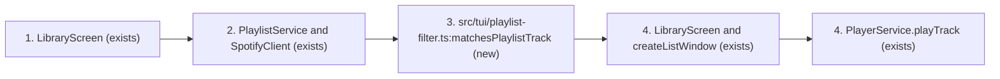
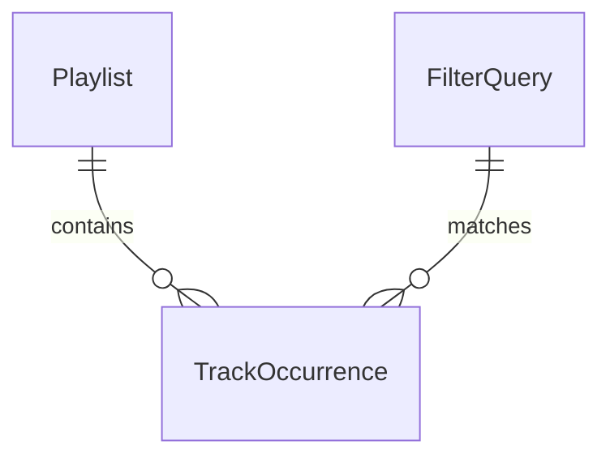
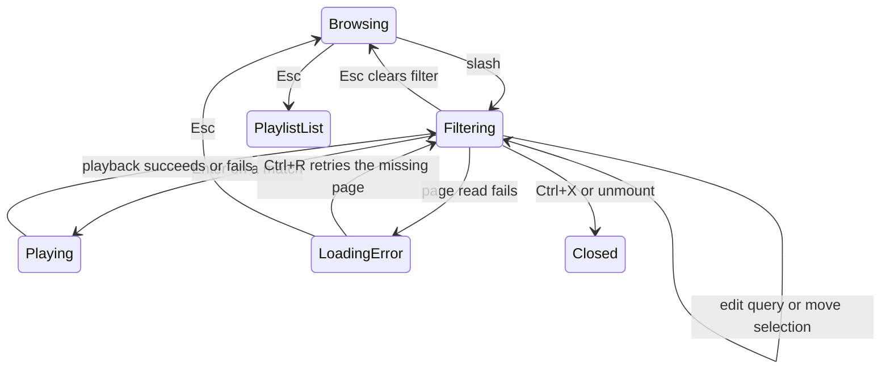

# Playlist track filtering

**Approved**: 2026-11-10 - user: "ok good to go"

The user accepted all-word, case/accent-insensitive matching, progressive results,
and delegated the remaining interaction details after accepting the core flow.

> Build this with **tlc-implement** from this approved plan. Every criterion becomes
> a check with a proof; open questions are not implementation defaults.

## Problem

Library displays playlist tracks in pages of 50. Finding a particular title or
artist requires manually browsing those pages. The user selected filtering within
playlists as the next feature; no quantitative usage evidence was provided.

Users can find and play matching tracks from an entire open playlist by title
or artist, then clear the filter without leaving that playlist.

## Shape

Reuse the Library screen, existing playlist page requests, session caches,
scrolling, and track playback. Matching and result selection must run in a layer
reachable by the existing Vitest tests, rather than only in JSX presentation.

1. `/` in an open playlist enters `LibraryScreen` (exists), which owns the query
   and filtering interaction.
2. `LibraryScreen` uses `PlaylistService.getPlaylistItemsPage` (exists) through
   `SpotifyClient` (exists) to read the entire playlist in pages of 50, reusing
   available session pages.
3. `src/tui/playlist-filter.ts:matchesPlaylistTrack` (new) matches the query against track title and artist names;
   all query words must appear in title or artist names after case/accent folding.
   Cached pages are reused and missing pages are loaded sequentially, updating
   matches and a loaded-track count after each page.
4. `LibraryScreen` displays matching tracks using `createListWindow` (exists).
   Enter passes the selected track to `PlayerService.playTrack` (exists), using
   the existing album-context behavior when an album URI is present.

**Changes underneath**

| Front | What changes |
| --- | --- |
| domain | An open playlist gains a filtered view spanning all its track pages. |
| stored data | Nothing to migrate; no persistent filter or catalog storage is proposed. |
| readers | Library track rows and keyboard hints; TUI Help and documentation describe the added control. |

New: nothing persisted; FilterQuery is transient screen state. Playlist and
TrackOccurrence describe existing Spotify data, not new stored entities.

Background reads continue while typing and playing. Esc and exit abort them;
failed reads retain partial matches and resume from the first uncached page on
Ctrl+R. An error or incomplete scan never claims there are no matches in the
entire playlist.

## Surface

None — no CLI command, public interface, or Spotify endpoint is added.
Existing authenticated playlist reads and player requests are reused.

## Landing

None — no dependency, persistent schema, or external contract is proposed.

## Criteria

### S1: Find and play a track within an entire playlist (P1)

Open a playlist, filter its tracks, play a match, and return to browsing.

**Acceptance Criteria**

1. WHEN the user presses `/` inside an open playlist THEN Library SHALL show `Filter:` input scoped to that playlist; category lists retain existing controls.
2. WHEN the query changes THEN matches SHALL contain every whitespace-separated query word in title or any artist, ignoring case and Unicode combining accents; an empty/whitespace query matches all loaded playable tracks. Album-only matches SHALL be excluded. Examples: `numb LINKIN` matches Numb by Linkin Park; `cafe beyonce` matches Café by Beyoncé; `numb missing` does not match Numb by Linkin Park.
3. WHILE filtering THEN results SHALL retain Spotify playlist order and duplicate occurrences, with no sorting or deduplication.
4. WHILE scanning THEN Library SHALL fetch missing pages sequentially with size 50, reuse cached pages, and show partial matches plus `Loading playlist…` and the number of playable tracks loaded. Changing the query SHALL not restart page requests.
5. WHILE filter input is active THEN `n`, `p`, `e`, and other printable characters SHALL edit the query; Backspace SHALL remove one grapheme; query changes reset selection to the first match. Up/Down SHALL select matches with the existing wrap behavior.
6. WHEN Enter is pressed on a selected match THEN exactly that track SHALL play using the existing album-context behavior; the query and result selection SHALL remain active, and background scanning SHALL continue. Empty result lists SHALL never start playback.
7. WHEN Esc is pressed during filtering THEN Library SHALL clear/close filtering, abort outstanding filter and playback requests, and restore the original playlist page and selected row. A subsequent Esc SHALL return to the playlist list.
8. WHEN filter mode ends, the component unmounts, or Ctrl+X exits THEN pending filter reads SHALL be aborted; late responses SHALL update neither the view nor the session cache.
9. IF a completed scan has zero matches THEN Library SHALL display `No matching tracks.`; an empty playlist SHALL also show zero loaded tracks. During an incomplete zero-match scan it SHALL display `Searching playlist…` instead.
10. IF a page request fails THEN Library SHALL retain partial matches and the query, show the sanitized Spotify error and `Ctrl+R` retry guidance, and resume the missing page on Ctrl+R without repeating cached reads. Existing bounded Spotify rate-limit handling SHALL be reused.
11. WHEN filtering is reopened in the same TUI session THEN cached playlist pages SHALL be reused; filter query and selection SHALL not persist after leaving filter mode. No catalog content SHALL be saved to disk.
12. WHILE filtering in a 40-column by 18-row TUI THEN query input and results SHALL remain within the viewport; long rows SHALL truncate and long result sets SHALL scroll to the selected match. Existing small-terminal exit controls SHALL remain available.
13. WHEN Help is opened THEN Library shortcuts SHALL include `/` filtering and `Ctrl+R` filter retry; README and website SHALL describe full-playlist title/artist filtering and Esc behavior.
14. WHILE filtering THEN playlist editing/reordering SHALL not run from printable shortcut keys; after Esc the existing edit controls SHALL work on the restored unfiltered selection.

## Out of scope

| Excluded | Why |
| --- | --- |
| Filtering playlist names, Liked, Recent, or Top categories | The selected feature filters tracks inside an open playlist. |
| Album-name matching | The accepted recommendation matches title and artist. |
| Track action menus, bulk selection, video, presets, JSON output, direct-link playback | Separate feature suggestions, not this request. |
| New CLI filtering commands | This flow concerns the interactive Library screen. |

## Assumptions

| Assumption | Chosen default | Rationale | Confirmed? |
| --- | --- | --- | --- |
| Core flow | Entire playlist, title/artist, `/`, arrows, Enter playback, Esc clear | User: "ok", followed by "ok good to go". | y |
| Matching and loading | All words; ignore case and accents; progressive results | User: "ok good to go" in response to the explicit recommendations. | y |
| Remaining interaction details | Preserve order/duplicates, retain filter after playback, restore original position on Esc; use Ctrl+R for retry so `r` remains text; session-only cache, sequential reads, no edit actions while typing | user delegated: "ok good to go" in response to "May I choose the remaining interaction details using the existing TUI conventions?" | y |

**Open questions:** none - all resolved or delegated.

## Differences from the source

None — there is no binding visual capture for the filter feature.

## Sources

- Conversation, 2026-11-09–10 — binding: user chose filtering within playlists;
  accepted the main flow with "ok" and the final matching, loading and delegation choices with "ok good to go".
- `src/tui/library-screen.tsx` — existing 50-track playlist pages, input,
  session cache, editing, selection, playback, and viewport behavior.
- `src/services/playlist.service.ts:getPlaylistItemsPage` — existing page reads.
- `src/tui/navigation.ts:LIBRARY_SHORTCUTS` — existing shortcut descriptions.
- `tests/tui-library-screen.test.tsx` — reachable screen and paging tests.

- `src/tui/playlist-filter.ts` — pure matching rule reached by unit tests.
